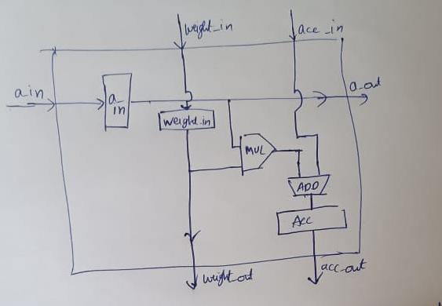
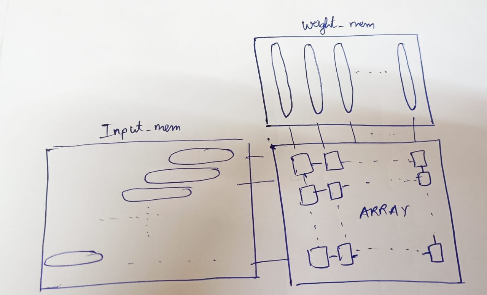
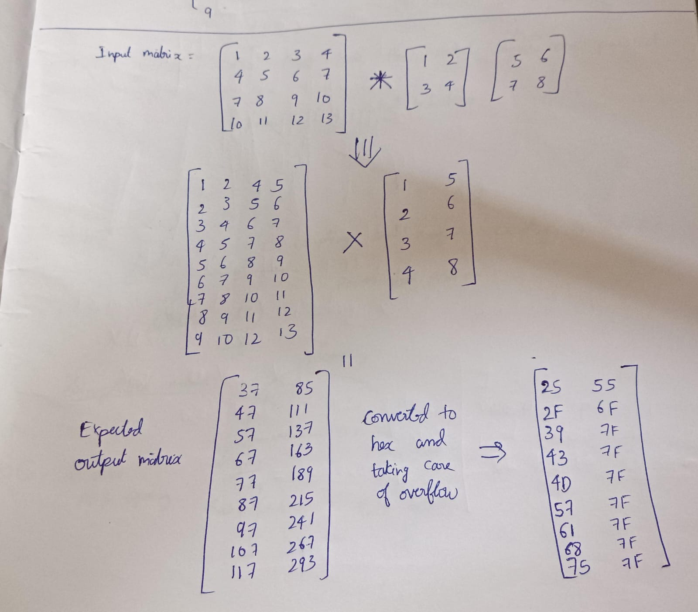

# Systolic Array Accelerator for Convolution

[](https://github.com/mithinKumar/Systolic-Array-Accelerator-for-Convolution/actions/workflows/ci.yml)
[](https://opensource.org/licenses/MIT)
[](https://en.wikipedia.org/wiki/C99)
[](https://cmake.org/)

A hardware-accelerated systolic array design for efficient convolution and matrix multiplication operations, targeting FPGA deployment with a CPU co-processing pipeline. Demonstrates a **~2.3× speedup** over CPU-only execution.

**Authors:**
- Mithin Kumar Pentapalli (22b1252@iitb.ac.in)
- Preetam Bhanoth (22b1254@iitb.ac.in)

---

## Table of Contents
- [Quick Start](#quick-start)
- [Prerequisites](#prerequisites)
- [Project Structure](#project-structure)
- [Architecture Overview](#architecture-overview)
- [Build and Run](#build-and-run)
- [Testing](#testing)
- [Docker](#docker)
- [FPGA Implementation](#fpga-implementation)
- [Performance Results](#performance-results)
- [Contributing](#contributing)
- [Security](#security)
- [License](#license)

---

## Quick Start

```bash
# Clone the repository
git clone https://github.com/mithinKumar/Systolic-Array-Accelerator-for-Convolution.git
cd Systolic-Array-Accelerator-for-Convolution

# Build the C simulation and run tests
make all
make test

# Run the interactive demo
make demo
```

## Prerequisites

| Tool | Version | Purpose |
|------|---------|---------|
| GCC | 9+ (C99) | Compile C simulation code |
| GNU Make | 3.81+ | Build automation |
| CMake | 3.16+ | Cross-platform build configuration |
| clang-format | 10+ | Code formatting (optional) |
| Docker | 20+ | Containerized builds (optional) |
| Yosys + nextpnr | Latest | FPGA synthesis (optional) |

## Project Structure

```
├── c_code_simulation/          # CPU-side simulation and preprocessing
│   ├── Makefile                # Build automation (all, test, clean, lint)
│   ├── CMakeLists.txt          # CMake target definitions
│   ├── matrix_ops.h            # Shared matrix operations header
│   ├── matrix_ops.c            # Core: matrix_multiply, extract_windows with bounds check
│   ├── logger.h                # Structured logging interface (DEBUG, INFO, WARN, ERROR)
│   ├── logger.c                # Timestamped logging implementation
│   ├── complete.c              # Full convolution pipeline (CPU-only)
│   ├── preprocessing.c         # Window extraction for systolic array
│   ├── demo.c                  # Interactive demo with printed output & logging
│   ├── test_framework.h        # Lightweight assertion-based test framework
│   ├── test_matrix_ops.c       # Automated test suite (12 unit tests)
│   ├── complete.asm            # RISC-V assembly (compiled from complete.c)
│   └── preprocessing.asm       # RISC-V assembly (compiled from preprocessing.c)
├── fpga_implementation/        # SystemVerilog FPGA design
│   ├── Makefile                # FPGA synthesis and flashing
│   ├── top.sv                  # Top-level module with UART interface
│   ├── array.sv                # Systolic array with Kogge-Stone adder
│   ├── uart_trx.sv             # UART transmitter/receiver
│   └── VSDSquadronFM.pcf       # Pin constraint file
├── tlv_files/                  # Transaction-Level Verilog source
│   └── array_final.tlv         # TL-Verilog systolic array design
├── images/                     # Architecture diagrams
│   ├── PE.jpg                  # Processing Element diagram
│   ├── array.jpg               # Array architecture diagram
│   └── TB.jpg                  # Testbench/UART output screenshot
├── .github/workflows/ci.yml    # CI pipeline (build, test, lint, static analysis)
├── Dockerfile                  # Multi-stage container build with health checks
├── docker-compose.yml          # One-command container startup
├── CMakeLists.txt              # Top-level CMake configuration
├── Makefile                    # Top-level Makefile
├── conanfile.txt               # Conan dependency manifest
├── conan.lock                  # Conan dependency lockfile
├── .env.example                # Sample environment variables
├── .clang-format               # Code style configuration (LLVM-based)
├── .gitignore                  # Git ignore rules
├── CONTRIBUTING.md             # Contribution guidelines
├── SECURITY.md                 # Security policy and vulnerability disclosure
├── LICENSE                     # MIT License
└── README.md                   # Project documentation
```

## Architecture Overview

### Weight-Stationary Systolic Array

We use a **weight-stationary model** optimized for AI inference workloads. Weights are loaded once into the array and remain stationary while input data flows through, minimizing memory access latency.



The overall array structure:



### Data Flow

1. **Weight Loading**: Weights are loaded into Processing Elements via the `weight_en` signal
2. **Input Streaming**: Input data flows horizontally through the array (`a_en` signal)
3. **Accumulation**: Partial sums propagate vertically, accumulating results
4. **Output Collection**: Final convolution results are read from the bottom of the array

### CPU-Accelerator Pipeline

The design uses separate local RAM for inputs, weights, and outputs. Data transfers between the systolic array and CPU use the **Wishbone** protocol.

**Convolution via Matrix Multiplication:**
1. `extract_windows()` — transforms input + filter dimensions into matrix form (im2col) with input validation
2. `matrix_multiply()` — performed by the systolic array (or CPU for simulation) with dimension validation
3. Results represent the convolution output

### Key Design Features
- **Scalable**: Array height and width configurable via parameters
- **Kogge-Stone Adder**: Low-latency parallel prefix addition
- **Wallace Tree Multiplier**: Efficient hardware multiplication
- **UART Interface**: Results transmitted to host for verification
- **Robust Error Handling**: Input validation with error return codes on all core functions
- **Structured Logging**: Built-in severity-based logging system (`DEBUG`, `INFO`, `WARN`, `ERROR`)

---

## Build and Run

### Building with Make

```bash
# Build all simulation binaries and test runner
make all

# Run the complete convolution (CPU-only simulation)
./c_code_simulation/complete

# Run preprocessing only (generates matrices for systolic array)
./c_code_simulation/preprocessing

# Run interactive demo with structured logging
./c_code_simulation/demo

# Clean build artifacts
make clean
```

### Building with CMake

```bash
# Configure and build
cmake -B build -S .
cmake --build build

# Run tests via CTest
ctest --test-dir build --output-on-failure
```

### FPGA Synthesis (requires Yosys + nextpnr + icestorm)

```bash
cd fpga_implementation

# Synthesize and generate bitstream
make build

# Flash to VSDSquadron Mini FPGA
make flash

# Open UART terminal to view output
make terminal
```

---

## Testing

The project includes an automated assertion-based test suite covering core matrix operations, sliding window extraction, boundary conditions, and logger levels.

```bash
# Run all tests
make test
```

### Expected Output:

```
Systolic Array Accelerator - Test Suite
========================================

Running test_matrix_multiply_identity...
  PASS
Running test_matrix_multiply_2x2...
  PASS
Running test_matrix_multiply_known_values...
  PASS
Running test_matrix_multiply_null_inputs...
  PASS
Running test_matrix_multiply_invalid_dimensions...
  PASS
Running test_extract_windows_count...
  PASS
Running test_extract_windows_values...
  PASS
Running test_extract_windows_3x3_filter...
  PASS
Running test_extract_windows_invalid_filter_too_large...
  PASS
Running test_extract_windows_invalid_filter_zero...
  PASS
Running test_extract_windows_null_inputs...
  PASS
Running test_logger_levels...
  PASS

========================================
Test Results: 12/12 passed
========================================
```

### Test Suite Breakdown

| Category | Tests | Description |
|----------|-------|-------------|
| Matrix Multiply | 3 | Identity matrix multiplication, 2×2 multiplication, known convolution values |
| Extract Windows | 3 | Window count verification, window values correctness, 3×3 filter extraction |
| Error Handling | 5 | NULL pointer rejection, zero/negative dimensions, oversized filters, zero filters |
| Observability | 1 | Logger level configuration and priority filtering |

---

## Docker

Build and run in an isolated container environment with integrated health checks:

```bash
# Run the demo via Docker Compose
docker compose up simulation

# Run automated tests in Docker
docker compose --profile test up test

# Build image manually
docker build -t systolic-array .
```

---

## FPGA Implementation

The systolic array is implemented in **SystemVerilog** and targets the **VSDSquadron Mini FPGA** (Lattice iCE40 UP5K).

### Hardware Components
- **`array.sv`**: Core systolic array with configurable dimensions, Kogge-Stone adder, and Wallace tree multiplier
- **`top.sv`**: Top-level module integrating the array with UART I/O
- **`uart_trx.sv`**: UART transmitter/receiver for host communication

### TL-Verilog Design
The initial design was prototyped in **Transaction-Level Verilog** (`tlv_files/array_final.tlv`), which provides a higher level of abstraction for rapid hardware design iteration.

### FPGA Demo



[Watch the FPGA Demo Video](https://drive.google.com/drive/folders/171VYndACv2W_u6io5pRV3rhXbbNptUDK?usp=sharing)

---

## Performance Results

### CPU-Only vs CPU + FPGA Accelerator

Benchmarked using the **Ripes simulator** with a 5-stage pipelined RISC-V 32IM processor.

| Configuration | Cycles | Breakdown |
|--------------|--------|-----------|
| **CPU Only** | 7,534 | Full convolution in software |
| **CPU + FPGA** | 3,231 | Preprocessing: 3,003 + Array: 24 + Transfer: 204 |
| **Speedup** | **2.33×** | |

The systolic array completes matrix multiplication in just **24 cycles**, compared to thousands for the CPU. The bottleneck shifts to preprocessing and data transfer.

---

## Contributing

Contributions are welcome! Please see [CONTRIBUTING.md](CONTRIBUTING.md) for guidelines on code style, formatting, pull requests, and commit standards.

## Security

Please see [SECURITY.md](SECURITY.md) for vulnerability disclosure procedures and security posture details.

## License

This project is licensed under the MIT License — see [LICENSE](LICENSE) for details.
